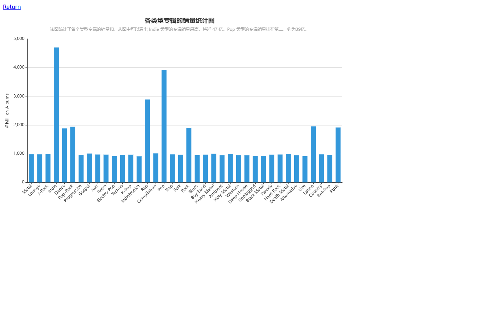
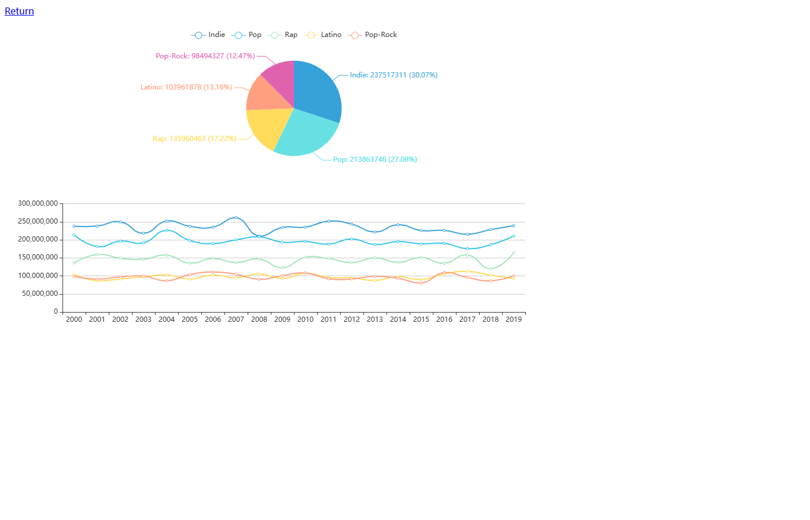
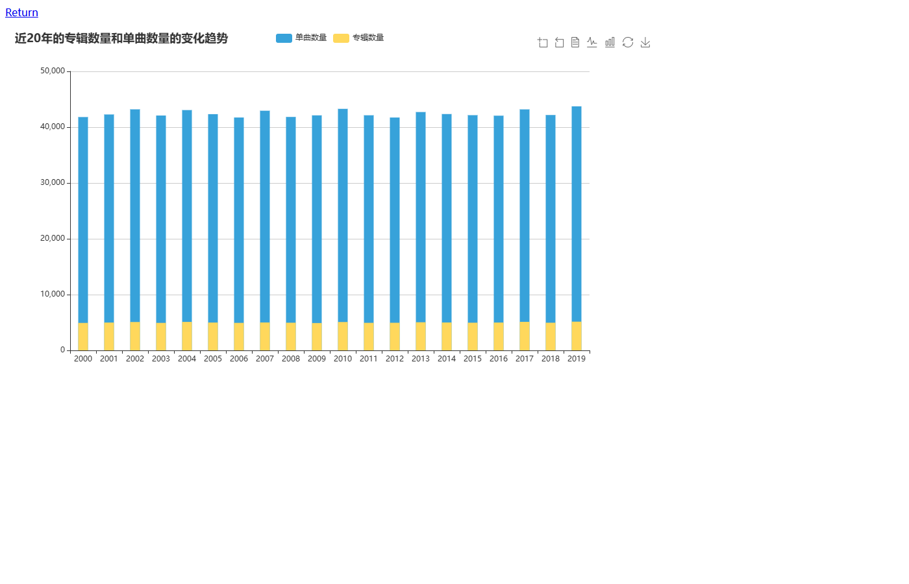
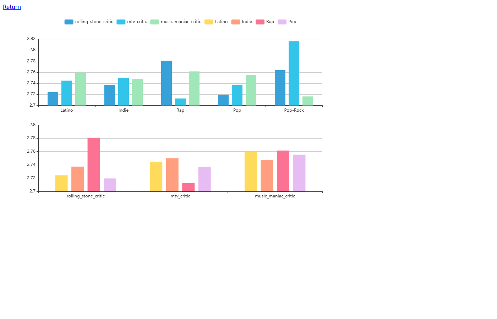

# 基于 PySpark 的音乐专辑销量数据分析看板

对 15,000+ 条音乐专辑销量数据进行 PySpark 清洗与统计分析，基于 Flask + ECharts 搭建交互式可视化看板，从品类结构、年度趋势、评分体系等维度完成数据洞察。

## 看板效果

**各类型专辑销量统计图**（ Indie 类销量最高，接近 47 亿，Pop 排名第二）：



**总销量前五的专辑类型的各年份销量分析图**：



**近20年每年发行的专辑数量和单曲数量统计图**：



**总销量前五的专辑类型的评分分析图**：



## 技术栈

- **数据处理**：PySpark（清洗、类型转换、去重、聚合统计）
- **后端**：Flask
- **可视化**：ECharts
- **数据规模**：15,000+ 条专辑销量记录（albums.csv）

## 项目结构

```
├── albums.csv                 原始数据（15,000+ 条）
├── code/
│   ├── main.py                PySpark 清洗与统计，输出 JSON
│   ├── SparkFlask.py          Flask Web 服务
│   ├── templates/             ECharts 页面模板
│   ├── static/data/           分析结果 JSON
│   └── static/js/             ECharts / jQuery
└── screenshots/               看板截图
```

## 运行方式

```bash
pip install -r requirements.txt
cd code
python main.py          # PySpark 统计分析，生成 JSON
python SparkFlask.py    # 启动看板，访问 http://127.0.0.1:5000
```

## 分析结论

- Indie 类型专辑总销量最高（接近 47 亿），Pop 排名第二（约 39 亿）
- 三大品类（Indie / Pop / Rap）合计占销量 76% 以上，品类集中度高
- 详见 [REPORT.md](REPORT.md)（数据流七环节完整报告）
